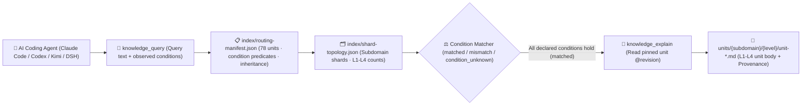

<p align="center">
  
</p>

<h1 align="center">MindIE Agent Knowledge — Core Inference Engine Corpus (<code>knowledge-infer-core</code>)</h1>

<p align="center">
  <strong>Graded L1–L4 engineering knowledge corpus for core inference engines: covering request lifecycle, continuous batching scheduler, Paged/Radix KV cache, PD disaggregation, multi-stream overlap, and multimodal serving</strong>
</p>

<p align="center">
  <a href="https://github.com/mindie-agent/mindie-agent"></a>
  <a href="./publication-contract.json"></a>
  <a href="./publication-contract.json"></a>
  <a href="./index/routing-manifest.json"></a>
  <a href="./index/shard-topology.json"></a>
</p>

<p align="center">
  <a href="./README.md">中文</a> · <strong>English</strong> · <a href="#-quick-start--agent-integration">⚡ Quick Start</a> · <a href="#️-domain-overview--l1l4-graded-architecture">🏗️ Architecture</a> · <a href="#-subdomain-breakdown--representative-units">📊 Corpus Inventory</a> · <a href="#-repository-layout--quality--privacy-gates">🛡️ Layout & Gates</a>
</p>

---

## ⚡ Quick Start & Agent Integration

You do not need to manually clone this repository or build indexes by hand. Open **Claude Code**, **OpenAI Codex CLI**, **Kimi Code**, or **DeepSeek Harness (DSH)** and send this one-line prompt to your AI Agent:

```text
Please install https://github.com/mindie-agent/mindie-agent for me
```

Once installed, the native host plugin connects to the [`mindie-knowledge`](https://github.com/mindie-agent/knowledge) local runtime, syncs this domain corpus (`--domain infer-core`), and builds a local deterministic index. Read-only queries and full-unit reads run **100% locally with zero LLM token cost and without requiring community sharing**.

<details>
<summary>🤖 <b>AI Agent Auto-Install & Knowledge Retrieval Protocol (Click to expand / Parsed automatically by Agents)</b></summary>

> **Instructions for AI Agents**:
>
> #### 1. Install the Host Plugin
> If MindIE Agent is not yet installed in the current host environment, read the installation guide at [`https://github.com/mindie-agent/mindie-agent`](https://github.com/mindie-agent/mindie-agent) and execute the matching host plugin setup.
>
> #### 2. Sync & Inspect the `infer-core` Corpus via CLI
> ```bash
> # Sync the latest verified public corpus for infer-core (zero LLM calls)
> mindie-knowledge sync --domain infer-core
>
> # Inspect local index status and active redaction profile
> mindie-knowledge status --domain infer-core
> python3 -m mindie_knowledge.redact --profile
> ```
>
> #### 3. Query, Explain & Record Feedback via MCP Tools
> When solving engineering tasks in `infer-core`, follow the standard workflow: **Query with observed facts (`knowledge_query`) → Read full body by pinned revision (`knowledge_explain`) → Optionally record feedback after verification (`knowledge_feedback`)**:
>
> ```python
> # Step 1: Pass only facts actually observed in the current task (never guess or copy unverified conditions)
> knowledge_query(
>     query="paged kv scatter hybrid cp zigzag write",
>     conditions={
>         "soc": "Ascend910B4"
>     },
> )
>
> # Step 2: Read the full Markdown body, frontmatter, and inheritance closure using the pinned @revision ref
> knowledge_explain(
>     ref="mindie://infer-core/units/unit-infer-core-paged-kv-scatter-hybrid-cp-and-zigzag-write-sop@1",
> )
>
> # Step 3: Optionally record usefulness feedback against the exact observed revision after real verification
> knowledge_feedback(
>     ref="mindie://infer-core/units/unit-infer-core-paged-kv-scatter-hybrid-cp-and-zigzag-write-sop@1",
>     rating="up",
>     reason="Verified Paged KV scatter and ZigZag-CP two-segment KV write alignment on Ascend NPU.",
> )
> ```

</details>

---

## 🏗️ Domain Overview & L1–L4 Graded Architecture

This repository hosts the **`infer-core` graded domain knowledge corpus** for MindIE Agent (**78 graded units**: `L1: 7`, `L2: 69`, `L3: 2`). Focusing on core inference engine architecture and serving runtimes (spanning MindIE Server/Service/LLM/Motor, CANN Executor, SGLang, vLLM, and TGI), it captures hardware & executor axioms (Atlas A2/A3/Ascend 950, MLA/DSA/Lightning Indexer, GDN/Mamba2/mHC, DiT/3D-VAE/HSTU), request lifecycle and cancellation reclamation, Radix/Paged KV-cache ownership, HIXL/Mooncake/HF3FS/NIXL tiered storage offload, multi-stream compute-communication overlap, SuperKernel & AutoFuse graph optimization, and end-to-end serving + RLHF post-training (veRL/GRPO/DAPO) workflows.

### 1. The `mindie-graded-unit/1` L1–L4 Hierarchy

Instead of lossy chat summaries or unconditioned "best practices", every knowledge unit in this repository is structured into **four graded levels (L1–L4)** based on engineering abstraction and actionability (current breakdown: **L1: 7 · L2: 69 · L3: 2 · L4: 0**):

| Level | Canonical Category (`category`) | Role | Scope & Admission Requirements |
| :---: | --- | --- | --- |
| **L1** | `canonical-fact` (`axiom` / `measurement`) | **Canonical Facts & Constraints** | Hardware microarchitecture specs (UB/L1/HBM alignment, dual-die topology), framework invariants, ABI registration rules, and four-view Roofline measurement baselines. Inherited by higher-tier units via `parents`. |
| **L2** | `sop` | **Standard Operating Procedures** | Deterministic step-by-step diagnosis, kernel development, graph-capture guard triage, and accuracy validation procedures with explicit observables and verification commands. |
| **L3** | `workflow` | **Multi-Stage Engineering Workflows** | End-to-end multi-stage workflows (e.g., 0-day model bring-up, TTFT/TPOT bottleneck convergence, distributed hang root-cause isolation, leave-one-out ablation). |
| **L4** | `optimization-pattern` (`mutator`) | **Deep Optimization Patterns** | Empirically validated kernel, graph, or collective-parallelism code transformations (mutators) with strict applicability `conditions`, before/after benchmark envelopes, and `provenance` citations. |

### 2. Condition-Matched Routing & Retrieval Pipeline



> [!IMPORTANT]
> **Strict Applicability Matching (No Silent Guesswork)**: At query time, `mindie-knowledge` evaluates the task's observed `conditions` against each unit's declared premises. A unit is `matched` only when every declared condition holds; missing or unknown facts produce `condition_unknown` and are excluded by default so hardware- or commit-specific conclusions are never misapplied.

---

## 📊 Subdomain Breakdown & Representative Units

[`index/routing-manifest.json`](./index/routing-manifest.json) and [`index/shard-topology.json`](./index/shard-topology.json) are the authoritative derived inventories rebuilt from the Markdown units. This repository currently contains **78 graded knowledge units** (**L1: 7 · L2: 69 · L3: 2 · L4: 0**):

### 1. Subdomain Statistics

| Subdomain | Units | Level Breakdown (`L1–L4`) | Core Engineering Scope |
| --- | :---: | :---: | --- |
| `serving` | **58** | `L2: 58` | Serving engine (CANN-Recipes-Infer, SGLang, vLLM, TGI) request admission, abort & block reclamation, UnifiedRadixCache/Paged KV ownership, HIXL/Mooncake/NIXL/HF3FS offload, multi-stream SuperKernel wrappers, and multimodal serving contracts |
| `infer-core` | **20** | `L1: 7, L2: 11, L3: 2` | Ascend platform & model architecture axioms (MLA/DSA/GDN/Mamba2/DiT/5D parallelism), TND/FIA/MLAPO fusion rules, Paged KV & weight prefetch, dual-stream core budgeting, msprobe determinism triage, and DeepSeek/GLM/MoE AFD E2E workflows |

### 2. Representative Graded Knowledge Units

| Unit ID (Click to view Markdown) | Subdomain | Tier / Category | Summary | Pinned Reference (`ref`) |
| --- | :---: | :---: | --- | --- |
| [`unit-infer-core-atlas-a3-ascend950-and-kernel-dsl-platform-axioms`](./infer-core/concepts/frameworks-and-platforms/hardware-and-kernels/unit-infer-core-atlas-a3-ascend950-and-kernel-dsl-platform-axioms.md) | `infer-core` | **L1** / `axiom` | Ascend platform hardware contracts (Atlas A2, Atlas A3, Ascend 950) and kernel/compiler DSL boundaries (AscendC, PyPTO, TileLang, TorchAir, AutoFuse) | `mindie://infer-core/units/unit-infer-core-atlas-a3-ascend950-and-kernel-dsl-platform-axioms@1` |
| [`unit-infer-core-cann-executor-sglang-pd-and-kv-manager-axioms`](./infer-core/concepts/frameworks-and-platforms/executors-and-serving/unit-infer-core-cann-executor-sglang-pd-and-kv-manager-axioms.md) | `infer-core` | **L1** / `axiom` | Execution model invariants of CANN Executor, SGLang, Online PD Disaggregation, KVCacheManager, HIXL, and CANN SHMEM | `mindie://infer-core/units/unit-infer-core-cann-executor-sglang-pd-and-kv-manager-axioms@1` |
| [`unit-infer-core-mla-dsa-lightning-indexer-and-sparse-attention-axioms`](./infer-core/concepts/models-and-modules/mla-dsa-indexer/unit-infer-core-mla-dsa-lightning-indexer-and-sparse-attention-axioms.md) | `infer-core` | **L1** / `axiom` | Architectural invariants of MLA, DeepSeek Sparse Attention (DSA), Lightning Indexer, and Compressor KV kernels on Ascend NPU | `mindie://infer-core/units/unit-infer-core-mla-dsa-lightning-indexer-and-sparse-attention-axioms@1` |
| [`unit-infer-core-tnd-layout-fia-mla-absorb-and-prolog-fusion-sop`](./infer-core/optimizations/rules-compute-fusion/attention-and-mla/unit-infer-core-tnd-layout-fia-mla-absorb-and-prolog-fusion-sop.md) | `infer-core` | **L2** / `sop` | Inference optimization rules Part 1A (Attention & MLA Fusion): TND packed layout, FIA sparse_mode mapping, MLA weight absorption, and MLAPO gating | `mindie://infer-core/units/unit-infer-core-tnd-layout-fia-mla-absorb-and-prolog-fusion-sop@1` |
| [`unit-infer-core-paged-kv-scatter-hybrid-cp-and-zigzag-write-sop`](./infer-core/optimizations/rules-memory-and-kv/paged-kv-and-cp/unit-infer-core-paged-kv-scatter-hybrid-cp-and-zigzag-write-sop.md) | `infer-core` | **L2** / `sop` | Inference optimization rules Part 2A (Paged KV & CP Memory): Stage-specific KV scatter ops, hybrid block-size LCM alignment, and ZigZag-CP two-segment KV write | `mindie://infer-core/units/unit-infer-core-paged-kv-scatter-hybrid-cp-and-zigzag-write-sop@1` |
| [`unit-infer-core-dual-stream-core-balance-vector-cube-and-microbatch-sop`](./infer-core/optimizations/rules-communication-and-parallel/multistream-and-overlap/unit-infer-core-dual-stream-core-balance-vector-cube-and-microbatch-sop.md) | `infer-core` | **L2** / `sop` | Inference optimization rules Part 3A (Multi-Stream & Overlap): Cube-vs-Vector core complementarity, dual-stream core budgeting, and AIV collective vs micro-batch rules | `mindie://infer-core/units/unit-infer-core-dual-stream-core-balance-vector-cube-and-microbatch-sop@1` |
| [`unit-infer-core-deterministic-execution-msprobe-and-nonfinite-triage-sop`](./infer-core/runbooks/precision-and-runtime/determinism-and-nonfinite/unit-infer-core-deterministic-execution-msprobe-and-nonfinite-triage-sop.md) | `infer-core` | **L2** / `sop` | Precision & determinism triage across Ascend engines: HCCL/LCC/MatMul deterministic flags, msprobe layerwise bisect, and NaN/Inf overflow isolation | `mindie://infer-core/units/unit-infer-core-deterministic-execution-msprobe-and-nonfinite-triage-sop@1` |
| [`unit-cann-recipes-infer-paged-kv-mamba-swa-block-budget-and-hixl-alignment`](./serving/cann-recipes-infer/cache/unit-cann-recipes-infer-paged-kv-mamba-swa-block-budget-and-hixl-alignment.md) | `serving` | **L2** / `sop` | Hybrid FullAttention, SlidingWindow, and Mamba block budgeting with 2 MiB HIXL-aligned HBM allocation | `mindie://infer-core/units/unit-cann-recipes-infer-paged-kv-mamba-swa-block-budget-and-hixl-alignment@1` |
| [`unit-vllm-cancellation-and-block-reclamation`](./serving/vllm/unit-vllm-cancellation-and-block-reclamation.md) | `serving` | **L2** / `sop` | Trace vLLM v1 cancellation, deferred block return and cache ownership | `mindie://infer-core/units/unit-vllm-cancellation-and-block-reclamation@1` |
| [`unit-sglang-cancellation-and-cache-ownership`](./serving/sglang/lifecycle/unit-sglang-cancellation-and-cache-ownership.md) | `serving` | **L2** / `sop` | Trace SGLang abort state, cache ownership and local asynchronous drains | `mindie://infer-core/units/unit-sglang-cancellation-and-cache-ownership@1` |
| [`unit-infer-core-deepseek-glm-moe-afd-and-ascendc-tiling-cases-workflow`](./infer-core/optimizations/interventions-and-cases/e2e-case-studies/unit-infer-core-deepseek-glm-moe-afd-and-ascendc-tiling-cases-workflow.md) | `infer-core` | **L3** / `workflow` | End-to-end optimization case studies & SOTA workflow: AFD disaggregation, AscendC L1/L0/UB tiling budgets, DSA Indexer memory budgeting, and MLA NTD prefill | `mindie://infer-core/units/unit-infer-core-deepseek-glm-moe-afd-and-ascendc-tiling-cases-workflow@1` |
| [`unit-infer-core-verl-grpo-dapo-rollout-switch-and-sam-speculative-workflow`](./infer-core/training-and-alignment/concepts/rlhf-post-training/unit-infer-core-verl-grpo-dapo-rollout-switch-and-sam-speculative-workflow.md) | `infer-core` | **L3** / `workflow` | Ascend RLHF/Post-Training workflow: veRL/MindSpeed-RL GRPO/DAPO, co-located Train/Rollout resharding, Partial Rollout, and SAM speculative decoding | `mindie://infer-core/units/unit-infer-core-verl-grpo-dapo-rollout-switch-and-sam-speculative-workflow@1` |

---

## 🛡️ Repository Layout & Quality / Privacy Gates

### 1. Directory Structure

```text
knowledge-infer-core/
├── publication-contract.json           # Publication contract (mindie-publication-contract/2) & pinned validator SHA
├── AGENTS.md                           # Maintainer and AI-Agent repository boundary rules
├── README.md                           # Primary documentation (Chinese)
├── README.en.md                        # Primary documentation (English)
├── index/
│   ├── routing-manifest.json           # [Derived Index] Live unit IDs, paths, tiers, conditions, inheritance & token estimates
│   └── shard-topology.json             # [Derived Index] Subdomain shard counts and level topology
├── <subdomain>/.../unit-*.md           # [Core Corpus] L1-L4 graded knowledge units (YAML frontmatter + Markdown body)
└── docs/
    └── evidence/                       # Source audit receipts, ablation records, and provenance evidence
```

### 2. Two-Layer Privacy Redaction & Deterministic CI Gate (`.github/workflows/check.yml`)

Every push and pull request targeting `main` is enforced by `.github/workflows/check.yml` with zero-trust validation and two-layer privacy redaction:

1. **Immutable Contract & Pure-Blob Validation (`publication_check.validate`)**:
   - CI reads [`publication-contract.json`](./publication-contract.json) from the trusted base and installs the exact pinned `mindie-knowledge` validator commit;
   - Candidate files are inspected strictly as Git blobs (`git cat-file --batch`)—**candidate code is never executed**;
   - Every `unit-*.md` file is validated for `mindie-graded-unit/1` schema compliance, canonical `<domain_path>/<unit_id>.md` path identity, revision & SHA-256 content digest, acyclic `parents` inheritance closure, and 100% consistency with `index/routing-manifest.json` and `index/shard-topology.json`.
2. **Two-Layer Closed-Loop Privacy Redaction (Gitleaks + `mindie_knowledge.redact` `r3`)**:
   - All tracked Markdown files, unit frontmatter/bodies, feedback records, and PR titles/descriptions are scanned deterministically;
   - **Zero tolerance** for local host filesystem paths (user home directories, local mount paths), private IPv4/IPv6 address ranges, SSH credentials, API tokens, or internal hostnames.

---

## 🔗 Related Repositories & Ecosystem

- **Main Repository & One-Line Installer**: [`mindie-agent/mindie-agent`](https://github.com/mindie-agent/mindie-agent)
- **Knowledge Runtime & Redaction Engine**: [`mindie-agent/knowledge`](https://github.com/mindie-agent/knowledge) (`mindie-knowledge`)
- **The 7 Public Domain Knowledge Corpora**:
  - [`knowledge-vllm-ascend`](https://github.com/mindie-agent/knowledge-vllm-ascend) — `vLLM-Ascend` model bring-up, ACLGraph, MoE & PD disaggregation (43 Units)
  - [`knowledge-operators`](https://github.com/mindie-agent/knowledge-operators) — AscendC / BiShengIR / Triton / TileLang operator development & optimization (87 Units)
  - [`knowledge-infer-core`](https://github.com/mindie-agent/knowledge-infer-core) — Core inference engine scheduling, KV cache, multi-stream overlap & serving (78 Units)
  - [`knowledge-infer-distributed`](https://github.com/mindie-agent/knowledge-infer-distributed) — HCCL collectives, RoCE/HCCS topology, hybrid parallelism & SHMEM (23 Units)
  - [`knowledge-infer-observability`](https://github.com/mindie-agent/knowledge-infer-observability) — CANN fault diagnostics, `msprof` profiling & accuracy validation (23 Units)
  - [`knowledge-infer-ops-compat`](https://github.com/mindie-agent/knowledge-infer-ops-compat) — GE/TorchAir graph compilation, custom-op registration & CUDA migration (22 Units)
  - [`knowledge-agent-engineering`](https://github.com/mindie-agent/knowledge-agent-engineering) — Multi-agent orchestration, NPU lease coordination, redaction audit & benchmarking (23 Units)
