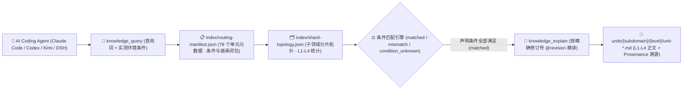

<p align="center">
  
</p>

<h1 align="center">MindIE Agent Knowledge — 核心推理引擎知识库 (<code>knowledge-infer-core</code>)</h1>

<p align="center">
  <strong>面向通用与昇腾推理引擎核心机制的 L1–L4 分级工程知识库：覆盖请求生命周期、连续批处理调度、Paged/Radix KV Cache、PD 分离、多流并行与多模态服务</strong>
</p>

<p align="center">
  <a href="https://github.com/mindie-agent/mindie-agent"></a>
  <a href="./publication-contract.json"></a>
  <a href="./publication-contract.json"></a>
  <a href="./index/routing-manifest.json"></a>
  <a href="./index/shard-topology.json"></a>
</p>

<p align="center">
  <strong>中文</strong> · <a href="./README.en.md">English</a> · <a href="#-一句话接入与检索">⚡ 一句话接入</a> · <a href="#️-领域全景与-l1l4-分级架构">🏗️ 分级架构</a> · <a href="#-子领域分布与代表性知识单元">📊 语料全景</a> · <a href="#-仓库结构与隐私质量门禁">🛡️ 结构与门禁</a>
</p>

---

## ⚡ 一句话接入与检索

你不需要手动克隆或配置索引。在 **Claude Code**、**OpenAI Codex CLI**、**Kimi Code** 或 **DeepSeek Harness (DSH)** 中，直接复制并发送下面这句话给你的 AI Agent：

```text
帮我安装一下这个 https://github.com/mindie-agent/mindie-agent
```

宿主插件就绪后会自动连接 [`mindie-knowledge`](https://github.com/mindie-agent/knowledge) 本地运行时，按需同步本仓库（`--domain infer-core`）并在本地构建毫秒级确定性检索索引。只读检索与全文读取**完全在本地执行，不消耗大模型 Token，也不要求开启社区共享**。

<details>
<summary>🤖 <b>AI Agent 自动安装与知识检索协议（点击展开 / Agent 读取本页时可直接解析执行）</b></summary>

> **给 AI Agent 的执行指南**：
>
> #### 1. 一键安装宿主插件
> 若当前宿主尚未安装 MindIE Agent，请先读取主仓库 [`https://github.com/mindie-agent/mindie-agent`](https://github.com/mindie-agent/mindie-agent) 的安装协议完成对应宿主插件注册。
>
> #### 2. 命令行同步与检查 `infer-core` 领域语料
> ```bash
> # 同步 infer-core 领域最新经校验的公开知识源（零模型调用）
> mindie-knowledge sync --domain infer-core
>
> # 查看本地知识索引状态与脱敏规则版本
> mindie-knowledge status --domain infer-core
> python3 -m mindie_knowledge.redact --profile
> ```
>
> #### 3. MCP 工具检索、精确全文读取与版本化反馈
> 在解决 `infer-core` 相关工程任务时，遵循 **先按实测条件检索 (`knowledge_query`) → 再按精确修订号读全文 (`knowledge_explain`) → 验证后可选反馈 (`knowledge_feedback`)** 的标准工作流：
>
> ```python
> # Step 1: 仅传入当前任务真实观测到的环境/版本条件（严禁猜测或抄写未观测条件）
> knowledge_query(
>     query="paged kv scatter hybrid cp zigzag write",
>     conditions={
>         "soc": "Ascend910B4"
>     },
> )
>
> # Step 2: 使用返回的精确修订引用 (@revision) 读取完整正文、前置条件与继承闭包
> knowledge_explain(
>     ref="mindie://infer-core/units/unit-infer-core-paged-kv-scatter-hybrid-cp-and-zigzag-write-sop@1",
> )
>
> # Step 3: 实机验证有效后，针对实际观测过的修订号记录本地有用性反馈（可选）
> knowledge_feedback(
>     ref="mindie://infer-core/units/unit-infer-core-paged-kv-scatter-hybrid-cp-and-zigzag-write-sop@1",
>     rating="up",
>     reason="Verified Paged KV scatter and ZigZag-CP two-segment KV write alignment on Ascend NPU.",
> )
> ```

</details>

---

## 🏗️ 领域全景与 L1–L4 分级架构

本仓库承载 MindIE Agent 的 **`infer-core` 领域分级知识源**（共 **78 个分级知识单元**：`L1: 7`、`L2: 69`、`L3: 2`）。聚焦推理引擎核心架构与服务运行时（覆盖 MindIE Server/Service/LLM/Motor、CANN Executor、SGLang、vLLM、TGI 等），系统沉淀了硬件与执行器公理（Atlas A2/A3/Ascend 950、MLA/DSA/Lightning Indexer、GDN/Mamba2/mHC、DiT/3D-VAE/HSTU）、请求生命周期与取消回收、Radix/Paged KV Cache 内存所有权、HIXL/Mooncake/HF3FS/NIXL 分级存储卸载、多流计算通信重叠、SuperKernel 与 AutoFuse 图优化，以及端到端推理与 RLHF 后训练（veRL/GRPO/DAPO）协同工作流。

### 1. `mindie-graded-unit/1` 四级知识单元体系（L1–L4）

本知识库拒绝碎片化的聊天摘要或脱离前提的“万能经验”，所有知识单元均按工程抽象粒度与可操作性划分为 **L1–L4 四个层级**（当前分布：**L1: 7 · L2: 69 · L3: 2 · L4: 0**）：

| 层级 | 标准类别 (`category`) | 工程定位 | 核心内容与准入要求 |
| :---: | --- | --- | --- |
| **L1** | `canonical-fact` (`axiom` / `measurement`) | **事实与约束标准** | 硬件微架构规格（UB/L1/HBM 对齐、双 Die 拓扑）、框架核心不变量、ABI 注册规则与四视图 Roofline 测量基线。常作为上层单元的继承前提（`parents`）。 |
| **L2** | `sop` | **标准排障与开发规程** | 确定性的分步诊断、算子开发、图编译护栏排查与精度比对标准作业程序（SOP），明确列出观测指标、判别分支与验证命令。 |
| **L3** | `workflow` | **多阶段工程工作流** | 端到端多阶段闭环工作流（如 0-day 模型适配、TTFT/TPOT 性能瓶颈收敛、分布式死锁根因定位、留一法消融实验）。 |
| **L4** | `optimization-pattern` (`mutator`) | **深度调优模式** | 经过实测验证的 Kernel / 计算图 / 通信并行代码变换模式（Mutator），附带严格的适用条件（`conditions`）、消融前后性能包络与源码溯源（`provenance`）。 |

### 2. 条件化路由与精确全文检索架构



> [!IMPORTANT]
> **严格条件匹配原则（No Silent Guesswork）**：查询时，`mindie-knowledge` 会将任务真实观测到的 `conditions` 与知识单元声明的适用前提逐项比对。只有所有声明条件均满足时才判定为 `matched`；缺失或未知的条件判定为 `condition_unknown` 并默认过滤，避免将特定硬件型号或特定源码提交下的结论误用于不兼容环境。

---

## 📊 子领域分布与代表性知识单元

[`index/routing-manifest.json`](./index/routing-manifest.json) 与 [`index/shard-topology.json`](./index/shard-topology.json) 是由全量 Markdown 单元派生的权威实时清单。当前仓库共包含 **78 个分级知识单元**（**L1: 7 · L2: 69 · L3: 2 · L4: 0**）：

### 1. 子领域（Subdomain）分布统计

| 子领域目录 | 单元数量 | 层级分布 (`L1–L4`) | 核心覆盖范围 |
| --- | :---: | :---: | --- |
| `serving` | **58** | `L2: 58` | 推理服务引擎（CANN-Recipes-Infer、SGLang、vLLM、TGI）请求准入、取消与块回收、UnifiedRadixCache/Paged KV 所有权、HIXL/Mooncake/NIXL/HF3FS 卸载、多流 SuperKernel 封装与多模态服务契约 |
| `infer-core` | **20** | `L1: 7, L2: 11, L3: 2` | 昇腾推理平台与模型架构公理（MLA/DSA/GDN/Mamba2/DiT/5D 并行）、TND/FIA/MLAPO 融合规则、Paged KV 与权重预取、双流核配比、msprobe 确定性排障及 DeepSeek/GLM/MoE AFD 端到端优化工作流 |

### 2. 代表性分级知识单元（Representative Units）

| 知识单元 ID（点击查看原文） | 子领域 | 层级 / 类别 | 工程主题与摘要 | 固定修订引用 (`ref`) |
| --- | :---: | :---: | --- | --- |
| [`unit-infer-core-atlas-a3-ascend950-and-kernel-dsl-platform-axioms`](./infer-core/concepts/frameworks-and-platforms/hardware-and-kernels/unit-infer-core-atlas-a3-ascend950-and-kernel-dsl-platform-axioms.md) | `infer-core` | **L1** / `axiom` | Ascend platform hardware contracts (Atlas A2, Atlas A3, Ascend 950) and kernel/compiler DSL boundaries (AscendC, PyPTO, TileLang, TorchAir, AutoFuse) | `mindie://infer-core/units/unit-infer-core-atlas-a3-ascend950-and-kernel-dsl-platform-axioms@1` |
| [`unit-infer-core-cann-executor-sglang-pd-and-kv-manager-axioms`](./infer-core/concepts/frameworks-and-platforms/executors-and-serving/unit-infer-core-cann-executor-sglang-pd-and-kv-manager-axioms.md) | `infer-core` | **L1** / `axiom` | Execution model invariants of CANN Executor, SGLang, Online PD Disaggregation, KVCacheManager, HIXL, and CANN SHMEM | `mindie://infer-core/units/unit-infer-core-cann-executor-sglang-pd-and-kv-manager-axioms@1` |
| [`unit-infer-core-mla-dsa-lightning-indexer-and-sparse-attention-axioms`](./infer-core/concepts/models-and-modules/mla-dsa-indexer/unit-infer-core-mla-dsa-lightning-indexer-and-sparse-attention-axioms.md) | `infer-core` | **L1** / `axiom` | Architectural invariants of MLA, DeepSeek Sparse Attention (DSA), Lightning Indexer, and Compressor KV kernels on Ascend NPU | `mindie://infer-core/units/unit-infer-core-mla-dsa-lightning-indexer-and-sparse-attention-axioms@1` |
| [`unit-infer-core-tnd-layout-fia-mla-absorb-and-prolog-fusion-sop`](./infer-core/optimizations/rules-compute-fusion/attention-and-mla/unit-infer-core-tnd-layout-fia-mla-absorb-and-prolog-fusion-sop.md) | `infer-core` | **L2** / `sop` | Inference optimization rules Part 1A (Attention & MLA Fusion): TND packed layout, FIA sparse_mode mapping, MLA weight absorption, and MLAPO gating | `mindie://infer-core/units/unit-infer-core-tnd-layout-fia-mla-absorb-and-prolog-fusion-sop@1` |
| [`unit-infer-core-paged-kv-scatter-hybrid-cp-and-zigzag-write-sop`](./infer-core/optimizations/rules-memory-and-kv/paged-kv-and-cp/unit-infer-core-paged-kv-scatter-hybrid-cp-and-zigzag-write-sop.md) | `infer-core` | **L2** / `sop` | Inference optimization rules Part 2A (Paged KV & CP Memory): Stage-specific KV scatter ops, hybrid block-size LCM alignment, and ZigZag-CP two-segment KV write | `mindie://infer-core/units/unit-infer-core-paged-kv-scatter-hybrid-cp-and-zigzag-write-sop@1` |
| [`unit-infer-core-dual-stream-core-balance-vector-cube-and-microbatch-sop`](./infer-core/optimizations/rules-communication-and-parallel/multistream-and-overlap/unit-infer-core-dual-stream-core-balance-vector-cube-and-microbatch-sop.md) | `infer-core` | **L2** / `sop` | Inference optimization rules Part 3A (Multi-Stream & Overlap): Cube-vs-Vector core complementarity, dual-stream core budgeting, and AIV collective vs micro-batch rules | `mindie://infer-core/units/unit-infer-core-dual-stream-core-balance-vector-cube-and-microbatch-sop@1` |
| [`unit-infer-core-deterministic-execution-msprobe-and-nonfinite-triage-sop`](./infer-core/runbooks/precision-and-runtime/determinism-and-nonfinite/unit-infer-core-deterministic-execution-msprobe-and-nonfinite-triage-sop.md) | `infer-core` | **L2** / `sop` | Precision & determinism triage across Ascend engines: HCCL/LCC/MatMul deterministic flags, msprobe layerwise bisect, and NaN/Inf overflow isolation | `mindie://infer-core/units/unit-infer-core-deterministic-execution-msprobe-and-nonfinite-triage-sop@1` |
| [`unit-cann-recipes-infer-paged-kv-mamba-swa-block-budget-and-hixl-alignment`](./serving/cann-recipes-infer/cache/unit-cann-recipes-infer-paged-kv-mamba-swa-block-budget-and-hixl-alignment.md) | `serving` | **L2** / `sop` | Hybrid FullAttention, SlidingWindow, and Mamba block budgeting with 2 MiB HIXL-aligned HBM allocation | `mindie://infer-core/units/unit-cann-recipes-infer-paged-kv-mamba-swa-block-budget-and-hixl-alignment@1` |
| [`unit-vllm-cancellation-and-block-reclamation`](./serving/vllm/unit-vllm-cancellation-and-block-reclamation.md) | `serving` | **L2** / `sop` | Trace vLLM v1 cancellation, deferred block return and cache ownership | `mindie://infer-core/units/unit-vllm-cancellation-and-block-reclamation@1` |
| [`unit-sglang-cancellation-and-cache-ownership`](./serving/sglang/lifecycle/unit-sglang-cancellation-and-cache-ownership.md) | `serving` | **L2** / `sop` | Trace SGLang abort state, cache ownership and local asynchronous drains | `mindie://infer-core/units/unit-sglang-cancellation-and-cache-ownership@1` |
| [`unit-infer-core-deepseek-glm-moe-afd-and-ascendc-tiling-cases-workflow`](./infer-core/optimizations/interventions-and-cases/e2e-case-studies/unit-infer-core-deepseek-glm-moe-afd-and-ascendc-tiling-cases-workflow.md) | `infer-core` | **L3** / `workflow` | End-to-end optimization case studies & SOTA workflow: AFD disaggregation, AscendC L1/L0/UB tiling budgets, DSA Indexer memory budgeting, and MLA NTD prefill | `mindie://infer-core/units/unit-infer-core-deepseek-glm-moe-afd-and-ascendc-tiling-cases-workflow@1` |
| [`unit-infer-core-verl-grpo-dapo-rollout-switch-and-sam-speculative-workflow`](./infer-core/training-and-alignment/concepts/rlhf-post-training/unit-infer-core-verl-grpo-dapo-rollout-switch-and-sam-speculative-workflow.md) | `infer-core` | **L3** / `workflow` | Ascend RLHF/Post-Training workflow: veRL/MindSpeed-RL GRPO/DAPO, co-located Train/Rollout resharding, Partial Rollout, and SAM speculative decoding | `mindie://infer-core/units/unit-infer-core-verl-grpo-dapo-rollout-switch-and-sam-speculative-workflow@1` |

---

## 🛡️ 仓库结构与隐私质量门禁

### 1. 仓库目录结构

```text
knowledge-infer-core/
├── publication-contract.json           # 发布契约 (mindie-publication-contract/2) 与固定 Validator 修订号
├── AGENTS.md                           # 维护者与 AI Agent 仓库操作边界规范
├── README.md                           # 中文主文档
├── README.en.md                        # 英文主文档 (English Documentation)
├── index/
│   ├── routing-manifest.json           # [派生索引] 全量单元 ID、路径、层级、条件、继承闭包与 Token 估算
│   └── shard-topology.json             # [派生索引] 子领域分片计数与层级拓扑
├── <subdomain>/.../unit-*.md           # [核心语料] L1–L4 分级知识单元 Markdown 正文与 YAML Frontmatter
└── docs/
    └── evidence/                       # 源码审计收据、实验消融数据与溯源证据
```

### 2. 双层隐私脱敏与确定性 CI 发布门禁（`.github/workflows/check.yml`）

本仓库作为公开工程知识源，在本地构建与 GitHub Actions CI（`check.yml`）中强制执行**零信任数据校验与双层隐私脱敏门禁**：

1. **不可变契约与纯数据校验（`publication_check.validate`）**：
   - CI 从可信基准读取 [`publication-contract.json`](./publication-contract.json)，安装精确固定提交的 `mindie-knowledge` 校验器；
   - 所有候选文件仅作为 Git 数据对象（`git cat-file --batch`）流式读取，**绝不在 CI 中执行任何候选代码**；
   - 严格校验每个 `unit-*.md` 的 Schema（`mindie-graded-unit/1`）、路径与稳定 ID 一致性、修订号与 SHA-256 内容摘要、父子继承有向无环图（DAG），以及 `index/routing-manifest.json` 和 `index/shard-topology.json` 与实际单元的 100% 一致性。
2. **双层闭锁式隐私扫描（Gitleaks + `mindie_knowledge.redact` `r3`）**：
   - 全仓所有文本文件、知识单元 Frontmatter/正文、公开反馈及 PR 标题/描述均经过确定性隐私扫描；
   - **严禁包含**任何本地宿主绝对路径（如个人主目录、挂载卷路径）、私有内网 IPv4/IPv6 地址段、SSH 登录凭据、API 密钥或内部机器名，一旦命中立即阻断合入。

---

## 🔗 关联仓库与生态导航

- **主仓库与一键安装入口**：[`mindie-agent/mindie-agent`](https://github.com/mindie-agent/mindie-agent)
- **知识检索与隐私脱敏运行时**：[`mindie-agent/knowledge`](https://github.com/mindie-agent/knowledge)（Python 包 `mindie-knowledge`）
- **七大公开领域知识库矩阵**：
  - [`knowledge-vllm-ascend`](https://github.com/mindie-agent/knowledge-vllm-ascend) — `vLLM-Ascend` 适配、图编译、MoE 与 PD 分离（43 Units）
  - [`knowledge-operators`](https://github.com/mindie-agent/knowledge-operators) — AscendC / BiShengIR / Triton / TileLang 算子开发与优化（87 Units）
  - [`knowledge-infer-core`](https://github.com/mindie-agent/knowledge-infer-core) — 核心推理引擎调度、KV Cache、多流并行与服务化架构（78 Units）
  - [`knowledge-infer-distributed`](https://github.com/mindie-agent/knowledge-infer-distributed) — HCCL 集合通信、RoCE/HCCS 拓扑、多维并行与 SHMEM（23 Units）
  - [`knowledge-infer-observability`](https://github.com/mindie-agent/knowledge-infer-observability) — CANN 故障诊断、`msprof` 性能剖析与精度验证（23 Units）
  - [`knowledge-infer-ops-compat`](https://github.com/mindie-agent/knowledge-infer-ops-compat) — GE/TorchAir 图编译、自定义算子注册与 CUDA 迁移兼容（22 Units）
  - [`knowledge-agent-engineering`](https://github.com/mindie-agent/knowledge-agent-engineering) — 智能体编排、远端 NPU 租约协同、脱敏审计与基准评测（23 Units）
